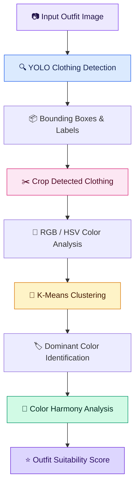

<div align="center">

# 👗 Smart Outfit Advisor

### AI-Powered Outfit Analysis & Style Recommendation System

**See your outfit. Understand your colors. Improve your style.**

An intelligent computer vision system that detects clothing items, analyzes their dominant colors, evaluates color harmony, and generates an overall outfit suitability score.

<br/>


<br/><br/>

<a href="https://github.com/esraayaser114/Smart-Outfit-Advisor">
  
</a>


</div>

---

## 📑 Table of Contents

<details open>
<summary><b>Explore the Project</b></summary>

- [✨ Overview](#-overview)
- [💡 Problem Statement](#-problem-statement)
- [🎯 Project Objectives](#-project-objectives)
- [🚀 Key Features](#-key-features)
- [⚙️ How It Works](#️-how-it-works)
- [🏗️ System Architecture](#️-system-architecture)
- [👚 Supported Clothing Classes](#-supported-clothing-classes)
- [🧠 Technology Stack](#-technology-stack)
- [📊 Model Performance](#-model-performance)
- [📦 Dataset Analysis](#-dataset-analysis)
- [📁 Project Structure](#-project-structure)
- [🛠️ Installation](#️-installation)
- [▶️ Usage](#️-usage)
- [🔮 Future Improvements](#-future-improvements)
- [👥 Team](#-team)
- [📄 License](#-license)

</details>

---

## ✨ Overview

**Smart Outfit Advisor** is an AI-powered fashion analysis project that combines **object detection, computer vision, and color analysis** to evaluate outfits from images.

Instead of treating an outfit as a single image, the system identifies individual clothing items, analyzes their visual characteristics, extracts their dominant colors, and examines color relationships to help assess the overall outfit.

<div align="center">

| 👕 Clothing Detection | 🎨 Color Analysis | ✨ Outfit Evaluation |
|:---:|:---:|:---:|
| Identify clothing categories | Extract dominant colors | Evaluate color harmony |
| Locate items in the image | Represent colors using RGB/HSV | Generate an outfit score |

</div>

### 🎬 Project Demo

The project demo video is available in the repository:

[`assets/project_demo.mp4`](assets/project_demo.mp4)

---

## 💡 Problem Statement

Choosing a visually coordinated outfit involves more than identifying individual clothing pieces. It also requires considering their colors, combinations, and overall visual consistency.

Traditional approaches may depend on manual inspection or predefined recommendations, making automated outfit analysis challenging.

**Smart Outfit Advisor** addresses this challenge by combining object detection with image-based color analysis to provide structured insights into clothing items and their color compatibility.

---

## 🎯 Project Objectives

- 🔍 Automatically detect multiple clothing items in an image.
- 🏷️ Identify the category of each detected item.
- ✂️ Extract individual clothing regions for further analysis.
- 🎨 Determine the dominant color of each clothing item.
- 🌈 Represent and analyze colors using RGB and HSV color spaces.
- 🧮 Apply K-Means clustering to extract dominant colors.
- 🗂️ Map extracted colors to human-readable color names.
- 🤝 Analyze color relationships and harmony.
- ⭐ Produce an overall outfit suitability score.

---

## 🚀 Key Features

<table>
<tr>
<td width="50%">

### 🔍 Intelligent Clothing Detection

- YOLO-based object detection.
- Clothing category prediction.
- Bounding-box localization.
- Confidence-based detection.

</td>
<td width="50%">

### 🎨 Dominant Color Extraction

- RGB and HSV color representations.
- K-Means clustering.
- Dominant color identification.
- Color-name mapping.

</td>
</tr>
<tr>
<td width="50%">

### 🌈 Color Harmony Analysis

- Analyze colors across detected clothing items.
- Examine relationships between dominant colors.
- Support outfit color-coordination assessment.

</td>
<td width="50%">

### ⭐ Outfit Suitability Evaluation

- Combine clothing and color-analysis outputs.
- Produce a score on a 10-point scale.
- Provide an additional perspective on outfit coordination.

</td>
</tr>
</table>

---

## ⚙️ How It Works

The system follows a multi-stage computer vision pipeline.

<div align="center">



</div>

### Pipeline Breakdown

| Stage | Process | Output |
|---|---|---|
| 01 | Image Input | Original outfit image |
| 02 | Clothing Detection | Detected classes, bounding boxes, and confidence scores |
| 03 | Clothing Cropping | Individual clothing regions |
| 04 | Color Analysis | RGB/HSV color information |
| 05 | K-Means Clustering | Dominant color candidates |
| 06 | Color Identification | Human-readable color names |
| 07 | Harmony Analysis | Color relationship assessment |
| 08 | Final Evaluation | Outfit suitability score |

---

## 🏗️ System Architecture

The project is organized into modular components, separating clothing detection, color analysis, suitability evaluation, and application-level integration.

```text
                   ┌──────────────────────┐
                   │     Input Image      │
                   └──────────┬───────────┘
                              │
                   ┌──────────▼───────────┐
                   │  Clothing Detection  │
                   │         YOLO         │
                   └──────────┬───────────┘
                              │
                   ┌──────────▼───────────┐
                   │   Clothing Cropping  │
                   └──────────┬───────────┘
                              │
                   ┌──────────▼───────────┐
                   │    Color Analysis    │
                   │   RGB / HSV / K-Means│
                   └──────────┬───────────┘
                              │
                   ┌──────────▼───────────┐
                   │  Suitability Analysis│
                   └──────────┬───────────┘
                              │
                   ┌──────────▼───────────┐
                   │  Outfit Score / 10   │
                   └──────────────────────┘
```

---

## 👚 Supported Clothing Classes

The custom clothing detection model supports **10 categories**:

<div align="center">

| 👜 Bag | 👗 Dress | 🎩 Hat | 🧥 Jacket | 👖 Pants |
|:---:|:---:|:---:|:---:|:---:|
| Bag | Dress | Hat | Jacket | Pants |

| 👕 Shirt | 👟 Shoe | 🩳 Shorts | 👗 Skirt | 🕶️ Sunglasses |
|:---:|:---:|:---:|:---:|:---:|
| Shirt | Shoe | Shorts | Skirt | Sunglasses |

</div>

---

## 🧠 Technology Stack

| Technology | Role in the Project |
|---|---|
|  | Core programming language |
|  | Clothing object detection |
|  | Image processing and computer vision |
|  | Numerical operations |
|  | Data handling and analysis |
|  | K-Means clustering |
| Matplotlib | Data visualization |
| PyYAML | Dataset configuration |

---

## 📊 Model Performance

The custom YOLO clothing detection model was evaluated on validation and test datasets.

### Validation Results

| Metric | Score |
|:---|---:|
| Precision | 76.13% |
| Recall | 78.83% |
| mAP@50 | 80.89% |
| mAP@50–95 | 54.66% |

### Test Results

| Metric | Score |
|:---|---:|
| Precision | 81.11% |
| Recall | 79.92% |
| mAP@50 | 83.38% |
| mAP@50–95 | 56.28% |

### 📈 Test Metrics at a Glance

<div align="center">


</div>

**Interpretation:** The test results show an mAP@50 of 83.38%. The difference between mAP@50 and mAP@50–95 also indicates that detection performance depends on the required localization precision.

> **Note:** These metrics describe the clothing detection model, not the accuracy of the final outfit suitability score.

---

## 📦 Dataset Analysis

The project uses a custom clothing dataset organized for YOLO object detection.

### Dataset Splits

```text
Dataset/
├── train/
├── valid/
└── test/
```

### Training Class Distribution

The following distribution was reported during dataset analysis:

<div align="center">

| Clothing Class | Distribution |
|---|---:|
| 👟 Shoe | 25.17% |
| 👕 Shirt | 18.01% |
| 👜 Bag | 13.92% |
| 🧥 Jacket | 9.38% |
| 👗 Skirt | 8.82% |
| 👗 Dress | 6.45% |
| 👖 Pants | 6.08% |
| 🩳 Shorts | 4.67% |
| 🕶️ Sunglasses | 4.20% |
| 🎩 Hat | 3.31% |

</div>

The distribution highlights differences in class representation. Less frequent categories, particularly small objects such as sunglasses, may benefit from additional training samples and targeted data augmentation.

---

## 📁 Project Structure

```text
Smart-Outfit-Advisor/
│
├── assets/
│   └── project_demo.mp4
│
├── Data/
│   └── color_names.csv
│
├── cropped_clothes/
│   ├── jacket_1.jpg
│   ├── shirt_0.jpg
│   └── shorts_2.jpg
│
├── notebooks/
│   ├── 1- YOLO Detection and Color Analysis.ipynb
│   ├── 2- Outfit Suitability.ipynb
│   └── Copy_of_clothing_detection_yolo26_(1).ipynb
│
├── src/
│   ├── clothing_detection.py
│   ├── color_analysis.py
│   ├── suitability.py
│   └── outfit_analyzer.py
│
├── app.py
├── best_yolo26l.pt
├── yolov8n.pt
├── requirements.txt
├── runtime.txt
└── README.md
```

### 📂 Main Components

| Component | Description |
|---|---|
| `src/clothing_detection.py` | Clothing detection functionality |
| `src/color_analysis.py` | Dominant color extraction and analysis |
| `src/suitability.py` | Outfit suitability evaluation |
| `src/outfit_analyzer.py` | Integration of analysis components |
| `app.py` | Application entry point |
| `Data/color_names.csv` | Color-name reference data |
| `notebooks/` | Experiments, analysis, and development |
| `assets/project_demo.mp4` | Project demonstration video |
| `best_yolo26l.pt` | Custom-trained clothing detection weights |
| `yolov8n.pt` | YOLO model weights |

---

## 🛠️ Installation

### 1. Clone the Repository

```bash
git clone https://github.com/esraayaser114/Smart-Outfit-Advisor.git
cd Smart-Outfit-Advisor
```

### 2. Create a Virtual Environment

**Windows:**

```bash
python -m venv venv
venv\Scripts\activate
```

**Linux / macOS:**

```bash
python3 -m venv venv
source venv/bin/activate
```

### 3. Install Dependencies

```bash
pip install -r requirements.txt
```

> **Model weights:** Ensure the required `.pt` files are available in the expected locations before running the application. The custom model weights may require Git LFS or another file-hosting method if they exceed GitHub's regular file-size limit.

---

## ▶️ Usage

After installing the dependencies, use the project's application entry point:

```bash
python app.py
```

The overall workflow is designed to:

1. Load the required model and configuration.
2. Receive an outfit image.
3. Detect clothing items.
4. Extract individual clothing regions.
5. Analyze dominant colors.
6. Evaluate color relationships.
7. Generate the outfit suitability result.

### 🔬 Example: Clothing Detection

The following illustrates the detection function interface used in the project workflow:

```python
from clothing_detection import detect_clothing

detected_items = detect_clothing(
    image,
    conf_threshold=0.35
)
```

**Note:** This snippet assumes the image variable and project module are already available in the execution environment. Depending on the module's import configuration, the import path may need to be adjusted.

---

## ⚠️ Limitations

Like other image-based systems, Smart Outfit Advisor has limitations:

- **Lighting conditions:** Shadows and poor illumination can affect color extraction.
- **Complex patterns:** Multiple colors and textures may make dominant color identification less representative.
- **Occlusion:** Partially hidden clothing items can be difficult to detect.
- **Small objects:** Categories such as sunglasses may be harder to localize accurately.
- **Class imbalance:** Uneven representation can affect performance across categories.
- **Subjectivity:** Color harmony and outfit suitability depend partly on design choices and personal preferences.

The generated score should be treated as an algorithmic assessment rather than an objective measure of fashion quality.

---

## 🔮 Future Improvements

- [ ] Improve detection of small objects such as sunglasses.
- [ ] Add more diverse training images.
- [ ] Apply targeted augmentation for underrepresented classes.
- [ ] Improve dominant color extraction for patterned clothing.
- [ ] Add skin-tone and background handling.
- [ ] Introduce outfit style classification.
- [ ] Add clothing compatibility recommendations.
- [ ] Build a web interface for image uploads.
- [ ] Add personalized fashion recommendations.
- [ ] Develop a real-time camera mode.
- [ ] Improve the final outfit scoring algorithm.
- [ ] Expand evaluation to cover the complete analysis pipeline.

---

## 👥 Team

This project was developed collaboratively by:

<div align="center">

| Team Member | Contribution |
|---|---|
| **Esraa Yasser** | Project development, integration, and deployment |
| **Sama Islam** | Clothing detection |
| **Rawan Tafeesh** | Color analysis |
| **Nicole Nader** | Outfit suitability evaluation |

</div>

---

## 📄 License

This project was developed for academic and educational purposes.

No specific open-source license is currently declared in this repository. If the team decides to distribute the project under an open-source license, an appropriate `LICENSE` file should be added.

---

<div align="center">

### ⭐ Smart Outfit Advisor

**See your outfit. Understand your colors. Improve your style.**

Made with 💜 using Computer Vision and Machine Learning.

<a href="https://github.com/esraayaser114/Smart-Outfit-Advisor">
  
</a>

</div>
